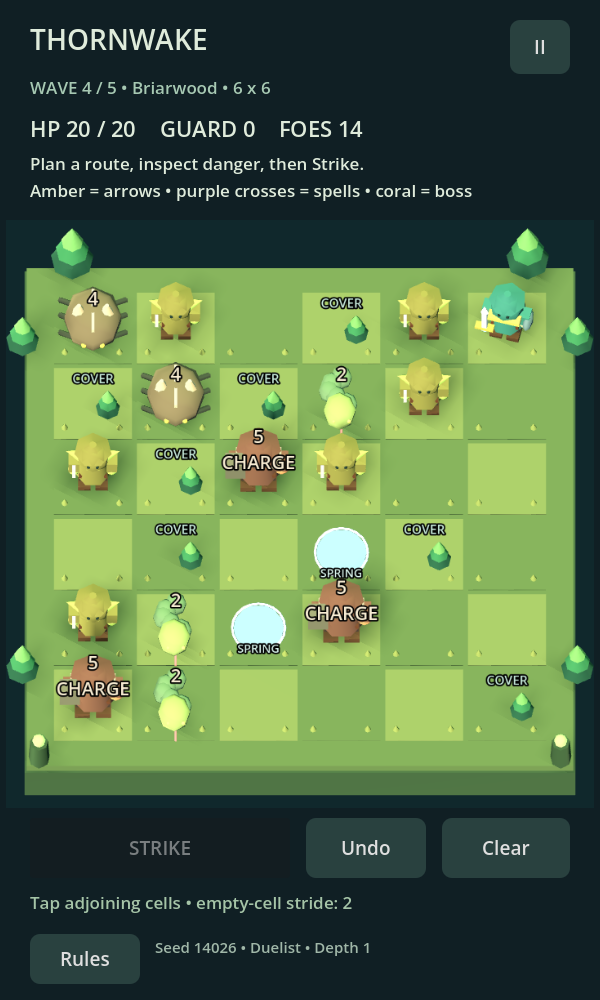

# Thornwake Expeditions — v0.5.0

A complete offline puzzle-action prototype for **Godot 4.7.2 stable**, standard GDScript edition, Compatibility renderer. Android portrait is the initial target. The board is 3D with procedural character animation and replaceable placeholder art.



## Play

Open `project.godot` in Godot 4.7.2 and press F5. Choose **Learn to play** first, then pack gear and scout an expedition. The scout report previews exact populations; Rescout changes the seeded hunt. No addons, accounts or network connection are needed to play.

Tap adjoining cells to plan a route; tap **Strike** to watch the adventurer dash, attack and take retaliation. Undo/Clear revise the plan without spending a turn. Two empty cells are allowed per route, plus Trail Boots bonuses. Paths cannot revisit cells. Weak attacks chip an armored foe and end movement before it. Momentum rewards chaining weaker enemies before attacking armor. The preview shows retaliation at your destination before committing.

**Duelist** favors concentrated hit power; **Reaver** adds a neighboring cleave. Cover blocks arrows; springs heal and cleanse poison. Damage resolves before healing, so healing cannot revive a lethal strike. Pause is available during animations. Losing focus pauses and checkpoints the last completed turn. Android Back pauses combat or returns from menus.

## Expedition

| Wave | Board | Escalation |
| --- | --- | --- |
| 1 | 3×3 | Scouts and armored shellbacks |
| 2 | 4×4 | Archers and poison vipers |
| 3 | 5×5 | Charging brutes and ground-marking hexers |
| 4 | 6×6 | Mixed threat puzzle |
| 5 | 6×6 | Heartroot Warden boss and minions |

Four seeded regular zones—Briarwood, Ashen Hollow, Frostfen and Moonlit Ruins—lead to Heartroot Sanctum. Layouts, terrain, enemy populations and camp choices vary reproducibly by seed. Camps offer one of two expedition boons, a stance switch and access to field loot/backpack crafting. Defeating the Warden wins immediately. Dying ends the run; packed gear and collected finds remain yours.

A win unlocks the next of five Depths. Higher Depths raise enemy health and eventually damage. Early runs use the full baseline mechanic. There are six gear bases, six rarity categories, thirteen Sigils, eleven exact-order Bindings, two sets, +6 upgrades (safe through +3, then 5%/10%/20% destruction), sockets and one-time 90% modifier / 10% destructive corruption. Matching enemies drop exclusive Sigils; the Warden has saved bad-luck protection. Six victory marks buy a chosen Set piece. See [gearing rules](docs/GEARING.md) and the [v0.5.0 update brief](docs/UPDATE_v0.5.0.md).

## Phase 3 scope and status

Implemented: title/tutorial/game/camp/results/retry loop; persistent gear and active-run saves; backup recovery; pause/restart; sound and reduced-motion settings; low/balanced render modes; safe-area layout; local diagnostic events; automated tests; Windows and Android export presets; CI export workflow; art replacement slots and handoff.

This is a **tested development candidate**, not a published store release. Actual local verification is recorded in [TEST_REPORT.md](TEST_REPORT.md). GitHub Actions has successfully exported debug Windows EXE/PCK and Android APK builds. Artifacts are available from the successful build run. No physical Android device testing or measured mobile performance has occurred. Debug signing is disposable and unsuitable for store release.

## Tune and extend

| File | Controls |
| --- | --- |
| `scripts/content.gd` | Board sizes, zone palettes, enemy HP/damage, camp boons |
| `scripts/rules.gd` | Population/layout generation, momentum, healing, boss patterns and Depth scaling |
| `scripts/gear.gd` | Shapes, affixes, caps, Sigil sources, recipes, risks, costs, drop rates and corruption odds |
| `scripts/board.gd`, `actor.gd` | Camera, effects, attack animation and procedural geometry |
| `scripts/main.gd` | UI, checkpoints, wave transitions and settlement |
| `scripts/save_store.gd` | Save validation/backup and local JSONL events |

The deterministic rules reducer is separate from presentation. The board animates the reducer's hit records, then commits the resulting state once. Loot and the checkpoint are saved together. Gear bonuses are snapshotted per wave; changing Vitality at camp preserves missing health before the normal +3 recovery.

## Verify and export

```sh
python3 tools/run_checks.py --godot /path/to/godot
```

Tests use an isolated temporary user-data directory. Render review: run `tests/visual_phase3.gd` with a graphical display. The CI workflow downloads matching official editor/templates, runs checks and attempts Windows debug EXE, PCK and Android debug APK exports. Artifacts expire after 14 days. No store deployment occurs.

For local Android export, install matching Godot export templates, JDK 17 and the Godot-compatible Android SDK, configure the editor export paths and debug keystore, then export the Android preset. Package ID is provisional: `com.alwaysbefarming.thornwake.prototype`. Offline save/log files are in Godot's `user://` folder, accessible through the editor's Open User Data Folder command. There is no remote analytics SDK; saves are editable local JSON, not tamper-resistant storage.

## Delivery notes

[Artist handoff](docs/ART_HANDOFF.md), [asset licenses](docs/ASSETS.md), [playtest hypotheses](docs/PLAYTEST.md), [store checklist](docs/RELEASE.md).

Biggest unresolved risk: strong gear makes Depth 1 easy, while higher Depths have not had human balance testing. The most valuable next improvement is tuning distinct enemy/gear combinations from observed player decisions and immediate retries. Run length targets 6–9 minutes including camps, but has not been measured with people.
